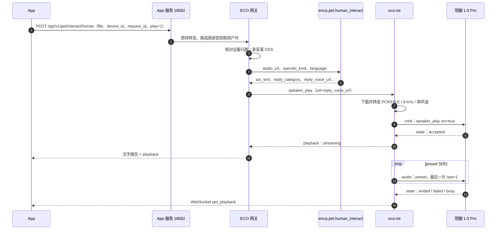

# App 请求与连接

App 只连接 App 服务。这次 cs 联调的地址是 `http://120.25.100.77:18082`，WebSocket 是 `ws://120.25.100.77:18082/api/v1/ws`。

App 不连接 EMQX，也不直接连接网关 `18080`。不保存商家密钥、席位密钥或 Device-Server 的登录令牌。通话时，媒体地址 `whip_url` 按第 6 节直接连接，不经过 App 服务。人翻宠按第 7 节只上传录音，项圈播放由服务端完成。

## 1. 拿到登录令牌

登录请求打到 App 服务，不带 `Authorization`。成功时 `data.access_token` 就是后面普通请求和 WebSocket 使用的登录令牌。同时保存 `data.refresh_token`。

密码登录：

```http
POST /api/v1/auth/login/password
Content-Type: application/json; charset=utf-8
```

```json
{"phone":"<手机号>","password":"<密码>","client_type":"app"}
```

短信登录先要验证码，再拿令牌。`scene` 固定为 `login`。

```http
POST /api/v1/auth/sms-code
```

```json
{"phone":"<手机号>","scene":"login"}
```

```http
POST /api/v1/auth/login/sms
```

```json
{"phone":"<手机号>","code":"<验证码>","client_type":"app"}
```

两种登录成功时，`data` 都是：

```json
{
  "access_token": "<登录令牌>",
  "refresh_token": "<刷新令牌>",
  "access_expires_at_ms": 0,
  "refresh_expires_at_ms": 0,
  "user_id": "<用户号>",
  "is_new_user": false
}
```

`access_token` 约 2 小时有效，`refresh_token` 约 30 天有效。到期时间看 `access_expires_at_ms` 和 `refresh_expires_at_ms`，单位是毫秒。

普通请求返回 HTTP 401 时，用刷新令牌再要一对新令牌。这个请求同样不带 `Authorization`。

```http
POST /api/v1/auth/refresh
```

```json
{"refresh_token":"<刷新令牌>"}
```

成功后用新的 `access_token` 重试刚才的请求。刷新失败就重新登录。

## 2. 普通请求

在 App 服务的地址后接路径。请求体是 JSON。

```http
Authorization: Bearer <登录令牌>
Content-Type: application/json; charset=utf-8
Accept: application/json
```

登录令牌用第 1 节拿到的 `access_token`。除第 1 节的登录和刷新外，请求都带这个头。

成功时 HTTP 2xx，正文是：

```json
{"code":0,"msg":"ok","data":{}}
```

`code` 为 `0` 或 `200` 时读取 `data`。失败时读 `msg`，没有 `msg` 时读 `message`。HTTP 401 按第 1 节刷新令牌或重新登录，不把这次请求改发到别的服务。

## 3. WebSocket

一条连接供多个订阅共用。地址：

```text
ws://120.25.100.77:18082/api/v1/ws?token=<access_token>
```

令牌放在查询参数 `token`，做百分号编码。不在查询参数里另带用户号。

连接建立后，服务端先发：

```json
{"type":"ready"}
```

客户端发送 JSON 文本：

| 动作 | 正文 |
| --- | --- |
| 订阅 | `{"action":"subscribe","topic":"<topic>"}` |
| 退订 | `{"action":"unsubscribe","topic":"<topic>"}` |
| 心跳 | `{"action":"ping"}` |

服务端的控制帧：

| type | 含义 |
| --- | --- |
| `ready` | 连接已建立 |
| `subscribed` | 该 `topic` 已订上 |
| `unsubscribed` | 该 `topic` 已退下 |
| `pong` | 心跳应答 |
| `error` | 这一帧失败，看 `topic` 和 `data` |

业务推送的帧形固定为：

```json
{"type":"<类型>","topic":"<topic>","data":{}}
```

同一条连接最多 8 个订阅。收到的二进制帧按 UTF-8 解成上面的 JSON，不能只接受字符串帧。

心跳 10 秒发送一次 `ping`。任意一条服务端帧都算连接还活着，包括 `pong` 和业务帧。连续 3 拍没有任何帧，也就是约 30 秒，判定连接已断。

意外断开后按 2 秒、5 秒、10 秒、20 秒、30 秒重试，之后改为每 60 秒一次。离开页面或关闭 App 时退订并关闭这一路，这一路不再重连。断线后补齐数据只请求一次，失败就继续靠上面的重连，不另做一套心跳。

## 4. 绑定项圈

先按第 1 节登录。绑定请求带第 2 节的 `Authorization`。序列号 `sn` 原样提交，区分大小写。当前 1.0 Pro 的序列号是 12 位小写 MAC，例如 `9030d6cb2703`。

猫狗项圈：

```http
POST /api/v1/scenarios/invoke
```

```json
{
  "scenario": "pet.scene",
  "step": "bind",
  "params": {},
  "query": {},
  "body": {
    "sn": "9030d6cb2703",
    "name": "猫狗项圈",
    "species": 2,
    "pet_species": 2,
    "product_type": "collar"
  }
}
```

马术项圈把 `scenario` 换成 `horse.scene`，`species` 和 `pet_species` 换成 `4`，`product_type` 仍是 `collar`。页面上手动绑定时不传 `pet_id`。要在绑定时关联宠物，再在 `body` 里加 `pet_id`。

成功时 `code` 为 `0`，`data` 是这台设备。之后用 `data.id` 访问这台项圈。未登记的序列号会按项圈建档，厂商是 `petcollar`，型号是 `COLLAR-CZL1`。

这台项圈已经属于当前登录用户时，再绑一次不会换主人。`name` 非空时会改设备名。已经属于别的用户时失败，`code` 为 `15001`，`msg` 为「设备已被绑定」。

解除绑定：

```http
DELETE /api/v1/devices/<data.id>
```

## 5. 项圈上行

姿态、定位、命令回执、电量、活动时长、录音、在线都走第 3 节那条 WebSocket。`topic` 里的设备号用第 4 节绑定成功时的 `data.id`，不用 MAC。进入项圈页时订上下面七条，离开页面或关闭 App 时退订并关闭，这一路不再重连。这七项不做定时轮询。同一条连接最多 8 个订阅，这七条可以订在一起。

| 数据 | 订阅 topic | 推送 type |
| --- | --- | --- |
| 姿态 | `pet_pose:<data.id>` | `pet_pose` |
| 定位 | `pet_location:<data.id>` | `pet_location` |
| 命令回执 | `pet_cmd:<data.id>` | `pet_cmd` |
| 电量 | `pet_battery:<data.id>` | `pet_battery` |
| 活动时长 | `pet_activity:<data.id>` | `pet_activity` |
| 录音 | `pet_mic:<data.id>` | `pet_mic` |
| 在线 | `device_online:<data.id>` | `device_online` |

订上之后，除在线外，如果已经有最新一条，服务端先推这一帧，之后再推新上报。还没有记录时不先推。在线见下面「在线」。

不是这台设备的主人时，服务端回 `error`。`data.msg` 分别是「无权订阅该设备姿态」「无权订阅该设备定位」「无权订阅该设备命令」「无权订阅该设备电量」「无权订阅该设备活动」「无权订阅该设备录音」「无权订阅该设备在线状态」。`data.id` 无法识别时，`data.msg` 是「deviceId 非法」。

意外断开后，除在线外，每一项只补一次。补齐请求带第 2 节的 `Authorization`。成功时 `data` 与该类型最后一条推送的 `data` 相同。还没有上报时 HTTP 成功，`data` 为 `null`。补齐失败就按第 3 节的间隔重连，不另做心跳。用户主动离开页面时不补齐。在线不另做 HTTP 补齐，重新订上 `device_online` 就会先拿到当前状态。

```http
GET /api/v1/pet/devices/<data.id>/pose-latest
GET /api/v1/pet/devices/<data.id>/location-latest
GET /api/v1/pet/devices/<data.id>/command-latest
GET /api/v1/pet/devices/<data.id>/battery
GET /api/v1/pet/devices/<data.id>/activity
GET /api/v1/pet/devices/<data.id>/mic-latest
```

`GET /api/v1/pet/devices/<data.id>/activity-latest` 与 `activity` 相同。活动时长保留最近 24 小时，过期后补齐结果为 `null`。录音地址见本节「录音」，可以反复打开。

### 在线

订上 `device_online:<data.id>` 后先推当前状态。24 小时内有过上线或离线时，先推最近这一次；否则按设备现在的 `online` 推。之后只在变成在线或变成离线时再推，不随每一拍姿态重复推。MQTT 只是连着、没有合格上报，不会推在线。

`connection_state` 这里只有 `online` 和 `offline`。`online` 为 `true` 时是 `online`，为 `false` 时是 `offline`。`ts` 是 Unix 秒。

```json
{
  "type": "device_online",
  "topic": "device_online:<data.id>",
  "data": {
    "device_id": "<data.id>",
    "online": false,
    "connection_state": "offline",
    "ts": 1795660000
  }
}
```

### 姿态

页面按 `data.pose_code` 显示。设备上报里的 `pet_action` 原样放在 `hardware_status` 和 `main_state`。

| 设备 `pet_action` | `pose_code` | `pose_label` |
| --- | --- | --- |
| `walk`、`walking` | `walk` | 行走 |
| `run`、`running` | `run` | 奔跑 |
| `still` | `still` | 静止 |
| `sleep` | `sleep` | 睡眠 |
| `rest` | `rest` | 休息 |
| `jump`、`jumping` | `jump` | 跳跃 |
| `eat`、`eating` | `eat` | 进食 |
| `play`、`playing` | `play` | 玩耍 |
| `drink`、`drinking` | `drink` | 饮水 |
| `slow_walk`、`slow_walking` | `slow_walk` | 慢走 |
| `static`，以及上表没有的词 | `other` | 其他 |

`id`、`device_id`、`pet_id`、`user_id`、`step_count`、`jump_count`、`reported_at_ms`、`analyzed_at_ms` 是字符串。`reported_at_ms` 的单位是毫秒。`result_json` 是一段 JSON 文本，不是对象。其余字段可能一并出现，多出来的字段保留，不要因为不认识就丢掉整帧。

定位不从姿态帧里取。这次姿态帧的 `latitude`、`longitude` 不作为项圈位置。

设备上报 `{"msgId":"pet11","ts":1795253137,"data":{"pet_action":"walking"}}` 时，推送是：

```json
{
  "type": "pet_pose",
  "topic": "pet_pose:<data.id>",
  "data": {
    "id": "<记录号>",
    "device_id": "<data.id>",
    "sn": "9030d6cb2703",
    "pose_code": "walk",
    "pose_label": "行走",
    "main_state": "walking",
    "hardware_status": "walking",
    "schema_id": "petcollar.snapshot",
    "reported_at_ms": "1795253137000"
  }
}
```

开机时带 `fw`、`hw` 的报文不会出现在这些推送里。

刷新页面后，内存里的推送会清空。打开项圈页时先拉历史，再订 `pet_pose`。新推送按 `id` 去重，插到列表前面。`pose-latest` 只补断线后的最新一条，不代替下面的分页。

```http
GET /api/v1/pet/devices/<data.id>/pose-records?limit=50
```

请求带第 2 节的 `Authorization`。`limit` 默认 50，最大 200。还可以带 `start_ms`、`end_ms`，单位是毫秒，用来限制 `reported_at_ms`。`include_raw=1` 时多一个 `raw_samples_json`；1.0 Pro 的 `pet_action` 没有六轴原文，这个字段为空。

成功时 `data.items` 按 `reported_at_ms` 从新到旧排列。每一项的字段与 `pet_pose` 推送的 `data` 相同。姿态看 `pose_code`、`pose_label`，步数看 `step_count`，体温看 `body_temp`，档案看 `pet_id`。这一拍没有步数或体温时，对应字段是 `0`。没有档案时 `pet_id` 是 `0`。

```json
{
  "code": 0,
  "msg": "ok",
  "data": {
    "items": [
      {
        "id": "<记录号>",
        "device_id": "<data.id>",
        "sn": "9030d6cb2703",
        "pet_id": "<档案号>",
        "pose_code": "walk",
        "pose_label": "行走",
        "main_state": "walking",
        "hardware_status": "walking",
        "step_count": "0",
        "body_temp": 0,
        "schema_id": "petcollar.snapshot",
        "reported_at_ms": "1795253137000"
      }
    ],
    "next_cursor": "<本页最后一条的 id>"
  }
}
```

`next_cursor` 非空时，用它取下一页：

```http
GET /api/v1/pet/devices/<data.id>/pose-records?limit=50&cursor=<next_cursor>
```

`next_cursor` 为空表示没有更旧的记录。不是这台设备的主人时，请求失败。

### 定位

`data` 就是设备定位报文去掉 `type` 之后的字段。`ts` 是 Unix 秒。`lat`、`lon` 沿用设备上报的值。`valid` 为 `false` 时这一帧不推送，经纬度也不作为轨迹点。推到页面上的定位帧，`valid` 都是 `true`。

`reason`：`oneshot` 是立即定位，或出行开、关时附带的那一次；`find` 是寻宠周期；`trip` 是出行周期；`schedule` 是空闲时大约每 5 分钟一次，电量保护中大约每 15 分钟一次；`move` 是连续非静止大约 50 秒后的一次。通话期间设备不开定位窗，这段时间没有新的定位帧。

```json
{
  "type": "pet_location",
  "topic": "pet_location:<data.id>",
  "data": {
    "ts": 1760580002,
    "reason": "oneshot",
    "lat": 22.54,
    "lon": 113.94,
    "sats": 8,
    "valid": true
  }
}
```

### 命令回执

`data` 对应设备在 `state` 上的 `cmd_result`，不带外层的 `type`。`ts` 是 Unix 秒。`cmd` 是命令名。`result` 为 `accepted`、`joining`、`in_call`、`success`、`ended`、`failed`、`busy` 之一。`joining` 和 `in_call` 只出现在 `cmd` 为 `voice_call` 的回执里。

`accepted`、`joining`、`in_call` 表示还在进行。`success` 和 `ended` 表示做完。`failed` 和 `busy` 表示没有做成。`code` 为 `0` 表示这一结果没有附带错误码。

通话按 `accepted`、`joining`、`in_call`、`ended` 推进。`ended` 是挂断或到达 `duration_min`。失败时顺序停在 `failed`，后面不再来 `ended`。`voice_call` 且 `result` 为 `failed` 时，可以多两个字段：`http` 是 WHIP 响应状态，范围 100 到 599；`detail` 是服务器正文，最多 40 个字符。连接没有到达 HTTP 时只有 `code`。

| `code` | 页面上的含义 |
| --- | --- |
| `0` | 这一结果没有附带错误码 |
| `-11` | 录音、播放、蜂鸣或通话占着音频 |
| `-12` | 未充电且电量不超过 10%，拒绝打开通话、闪光灯或蜂鸣。充电并且回到 15% 以上后可以再开 |
| `-21` | 通话缺少地址 |
| `-22` | 通话缺少令牌 |
| `-23` | 通话 SDP 无法使用 |
| `-24` | 通话 UDP 失败 |
| `-25` | 已有一通会话 |
| `-26` | 通话鉴权失败 |
| `-27` | WHIP 响应不是 201，看 `http` 和 `detail` |
| `-28` | 应答 SDP 无法使用 |
| `-29` | 通话地址无法使用 |
| `-30` | `gps_oneshot` 时是没有有效定位点；`voice_call` 时是音频打不开 |
| `-40` | 通话射频失败 |
| `-10` 到 `-17` | 通话还没有得到 HTTP 响应，这时没有 `http` 和 `detail` |

`find_light`、`buzzer`、`gps_oneshot`、`voice_call`、`speaker_play` 发出后 15 秒内一条回执都没有，WebSocket 上不会出现超时帧。`speaker_play` 的结果另看第 7 节的 `pet_playback`。已经收到 `accepted`、`joining` 或 `in_call` 之后，继续等后面的 `pet_cmd`。

```json
{
  "type": "pet_cmd",
  "topic": "pet_cmd:<data.id>",
  "data": {
    "ts": 1795254506,
    "cmd": "find_light",
    "result": "accepted",
    "code": 0
  }
}
```

通话失败时：

```json
{
  "type": "pet_cmd",
  "topic": "pet_cmd:<data.id>",
  "data": {
    "ts": 1795578607,
    "cmd": "voice_call",
    "result": "failed",
    "code": -27,
    "http": 400,
    "detail": "bad request"
  }
}
```

### 电量

打开项圈页时先查一次最近电量。请求带第 2 节的 `Authorization`。`<data.id>` 用绑定成功时的设备号，不用 MAC。

```http
GET /api/v1/pet/devices/<data.id>/battery
```

成功时 `data` 与 `pet_battery` 推送的 `data` 相同。`ts` 是 Unix 秒。`pct` 是电量百分比，范围 0 到 100，由电池电压换算：3300 mV 为 0，4200 mV 为 100。`chg` 为 `1` 表示正在充电，为 `0` 表示没有在充电。姿态报文的 `data` 里带 `pct`、`chg` 时，也会另推一帧同样的 `pet_battery`。USB 供电、没接电池时 `pct` 会在高位跳动。还没有电量上报时 HTTP 成功，`data` 为 `null`。不是这台设备的主人时请求失败。`data.id` 无法识别时，`msg` 是「deviceId 非法」。

```json
{
  "code": 0,
  "msg": "ok",
  "data": {
    "ts": 1795505055,
    "pct": 99,
    "chg": 1
  }
}
```

设备上报 `{"ts":1795505055,"type":"battery","pct":99,"chg":1}` 时，推送是：

```json
{
  "type": "pet_battery",
  "topic": "pet_battery:<data.id>",
  "data": {
    "ts": 1795505055,
    "pct": 99,
    "chg": 1
  }
}
```

姿态报文 `{"msgId":"pet12","ts":1760580004,"data":{"pet_action":"static","pct":99,"chg":1}}` 也会推出上面这一帧。姿态本身仍走 `pet_pose`。

### 活动时长

`static_s`、`walk_s`、`run_s` 是本次开机后的累计秒数。`state` 为 `static`、`walking`、`running` 之一，对应当时的姿态。姿态刚变化时不推这一帧；连续大约 60 秒姿态不变时推一条。只保留最近一条，24 小时后补齐为 `null`。

```json
{
  "type": "pet_activity",
  "topic": "pet_activity:<data.id>",
  "data": {
    "ts": 1760580064,
    "state": "static",
    "static_s": 300,
    "walk_s": 42,
    "run_s": 0
  }
}
```

断线后补齐：

```http
GET /api/v1/pet/devices/<data.id>/activity
```

`activity-latest` 的正文与这条相同。

### 录音

App 不下发 `mic_record`。设备把一段录音传完后，才推 `pet_mic`。半段、分片和预设音都不推。声音文件放在对象存储，页面只拿地址。`url` 是公网地址，没有到期时间，可以反复打开。

`fmt` 固定 `pcm16le`，`rate` 固定 `8000`。`ts` 是设备报文里的 Unix 秒。`bytes` 是整段 PCM 的字节数。`id` 是这一段自己的编号，两段不会共用同一个地址。

```json
{
  "type": "pet_mic",
  "topic": "pet_mic:<data.id>",
  "data": {
    "id": "<录音编号>",
    "ts": 1760580001,
    "fmt": "pcm16le",
    "rate": 8000,
    "bytes": 16000,
    "url": "https://<桶域名>/collar/mic/<data.id>/<录音编号>.pcm"
  }
}
```

`mic-latest` 的 `data` 与上面这一帧的 `data` 相同。还没有录音时 HTTP 成功，`data` 为 `null`。

历史列表从新到旧。`limit` 默认 20，最大 50。`cursor` 用上一页 `next_cursor`。

```http
GET /api/v1/pet/devices/<data.id>/mics?limit=20&cursor=<next_cursor>
```

成功时 `data.items` 每一项字段与 `pet_mic` 的 `data` 相同。`next_cursor` 为空表示没有更旧的录音。不是这台设备的主人时，请求失败。

## 6. 语音通话

开通和挂断打到 App 服务，带第 2 节的 `Authorization`。`<data.id>` 用绑定成功时的设备号。

```http
POST /api/v1/devices/<data.id>/command
```

`params_json` 是一段 JSON 文本，不是对象。`duration_min` 可省略，范围 1 到 60；省略时设备按 15 分钟。开通：

```json
{"command":"voice_call","params_json":"{\"on\":true,\"duration_min\":15}"}
```

成功时 `data.accepted` 为 `true`。`webrtc.whip_url` 是这一通的媒体地址，`webrtc.token` 是连这个地址用的令牌。通话能持续多久看请求里的 `duration_min`。`webrtc.expires_at` 只管这组地址和令牌，大约 10 分钟。

```json
{
  "code": 0,
  "msg": "ok",
  "data": {
    "accepted": true,
    "vendor_message_id": "pet/collar/1_0pro/9030d6cb2703/cmd",
    "webrtc": {
      "whip_url": "http://120.25.100.77:18196/whip/pion-9030d6cb2703",
      "token": "<令牌>",
      "expires_at": "2026-11-25T07:21:01Z"
    }
  }
}
```

挂断：

```json
{"command":"voice_call","params_json":"{\"on\":false}"}
```

成功时 `data` 只有 `accepted` 和 `vendor_message_id`，没有 `webrtc`。

媒体不走 App 服务，直接请求 `whip_url`。每次都带：

```http
Authorization: Bearer <webrtc.token>
```

带 SDP 的请求再加上 `Content-Type: application/sdp`。SDP 正文原样发送，不包进第 2 节的 `{"code","data"}`。

1. `POST whip_url`，正文是手机的 Offer。Offer 里要有 `PCMA/8000`。服务器按 Offer 里的原编码转发。成功时 HTTP 201，正文是 Answer。这一轮 Answer 可以是 `recvonly`，表示先只收手机的声音。
2. `GET whip_url`，等待服务器下一轮 Offer。10 秒内等到时 HTTP 200，正文是 Offer。项圈的声音加进来时，这一份 Offer 的方向是 `sendrecv`。10 秒内没有新 Offer 时 HTTP 204，正文为空。
3. `PUT whip_url`，正文是第 2 步那份 Offer 的 Answer。成功时 HTTP 204，正文为空。

第 2 步拿到 `sendrecv` 之后，把第 3 步发出去，手机才能播放项圈的声音。项圈要听到手机，它收到的 Answer 需要是 `sendrecv` 或 `sendonly`，并且里面有 `PCMA/8000`。令牌不对是 HTTP 401。房间已经没了是 HTTP 404。

进度看第 5 节的 `pet_cmd`，`cmd` 为 `voice_call`。旧报文里的 `agora_state` 不推给 App。

## 7. 人翻宠

主人对着手机说话，服务端识别后选一段猫叫或狗叫，在项圈上播放，并在同一次 HTTP 响应里返回文字报告。App 只发一次上传请求，不下发 `speaker_play`，不连接 MQTT，也不拿到 PCM。



### 7.1 上传录音

带第 2 节的 `Authorization`。请求体是 `multipart/form-data`，不是 JSON。

```http
POST /api/v1/pet/interact/human
Content-Type: multipart/form-data
```

| 字段 | 必填 | 说明 |
| --- | --- | --- |
| `file` | 是 | 录音文件。Android 是 MP3，iOS 是 AAC，H5 可能是 WAV；文件类型与内容要一致 |
| `device_id` | 播放时必填 | 第 4 节绑定成功时的 `data.id`，也接受序列号。不传时只返回报告，`playback.status` 为 `skipped` |
| `pet_id` | 否 | 宠物档案号，用来判断猫或狗 |
| `species_kind` | 否 | `cat` 或 `dog`。优先于档案 |
| `duration_ms` | 否 | 录音时长，整数毫秒 |
| `language` | 否 | 报告语言，例如 `zh`、`en` |
| `request_id` | 建议 | 这一次录音的编号，8 到 64 位，只能是字母、数字、`-`、`_`。见 7.3 |
| `play` | 要项圈播放时必填 | 传 `1` 时在项圈上播放。省略或传 `0` 时只返回报告，`playback.status` 为 `skipped`，与旧版行为一致 |

`play=1` 且不是这台设备的主人，或设备不存在时，请求在识别之前就失败，`code` 为 `10403` 或 `10404`，不扣识别次数。设备服务暂时不可用时不拦请求，照常返回报告，`playback.status` 为 `skipped`，原因看 `reason`。没有传 `play=1` 时不核对设备，也不会因设备问题失败。

这个请求要等识别和项圈接受播放，读超时按 120 秒设置。

### 7.2 响应

成功时 `code` 为 `0`。`data` 示例：

```json
{
  "code": 0,
  "msg": "ok",
  "data": {
    "request_id": "h2p-mf3k9a-7x2b1c9d",
    "message_id": "<互动编号>",
    "asr_text": "过来吃饭",
    "audio_url": "https://<桶域名>/analysis_media/<录音>.mp3",
    "reply_voice_url": "https://<桶域名>/voice_packs/cat/food_request_01.mp3",
    "reply_voice_key": "cat_food_request_01",
    "reply_voice_label": "求食",
    "reply_category": "求食呼叫",
    "reply_category_code": "food_request_call",
    "llm_reason": "主人在叫宠物吃饭",
    "emotion": "happy",
    "report": {
      "asr_text": "过来吃饭",
      "reply_category": "求食呼叫",
      "reply_category_code": "food_request_call",
      "reply_voice_label": "求食",
      "llm_reason": "主人在叫宠物吃饭",
      "emotion": "happy"
    },
    "playback": {
      "playback_id": "<播放编号>",
      "status": "streaming",
      "code": 0,
      "duration_ms": 1800
    }
  }
}
```

| 字段 | 说明 |
| --- | --- |
| `audio_url` | 主人刚才那段录音。**不是**项圈播放的声音 |
| `reply_voice_url` | 项圈播放的猫叫或狗叫。手机试听也用它 |
| `report` | 文字报告。字段与外层同名字段相同，只是收在一起。为空的字段是空字符串 |
| `asr_text` | 主人说的话。没有识别出时可能为空，这时仍会选一段默认叫声 |
| `llm_reason` | 为什么选这一段。也可能是「本地关键词」「识别为空」等降级说明 |
| `playback` | 项圈播放状态。见 7.4 |

报告成功、项圈没播成时，HTTP 仍然成功，`code` 为 `0`，只是 `playback.status` 不是 `streaming`。这时不要换新的 `request_id` 重发，那样会重新识别并扣次数；按 7.6 在手机上播放 `reply_voice_url` 即可。

识别失败时 `code` 不为 `0`，没有 `report`，也不会播放。

### 7.3 重试与 request_id

每段录音生成一个 `request_id`，网络超时、令牌刷新后重发时沿用同一个值。

- 10 分钟内用同一个 `request_id` 再发，直接返回第一次的 `data`，不再识别、不再播放。
- 第一次还没处理完时又发了一次，`code` 为 `10409`，`msg` 为「同一请求正在处理，请稍后用相同 request_id 重试」。隔几秒用同一个值再发即可。
- 不带 `request_id` 时每次都是新的一次，会重复识别和播放。

`request_id` 只在同一个登录用户下生效。

### 7.4 播放状态

`playback.status`：

| status | 含义 | 后续 |
| --- | --- | --- |
| `streaming` | 项圈已接受，正在推音频 | 等 `pet_playback` 推 `ended`、`failed`、`busy` 或 `timeout` |
| `preparing` | 已发命令，项圈还没回执 | 同上 |
| `ended` | 播完，或被停止 | 结束 |
| `busy` | 项圈音频被占用，例如正在通话或录音 | 结束。`code` 一般是 `-11` |
| `failed` | 没播成。`reason` 是原因 | 结束 |
| `timeout` | 10 秒内项圈没回执，或推完后没收到结束 | 结束 |
| `skipped` | 没传 `play=1`、没传 `device_id`，或设备服务暂时不可用 | 不会有推送 |
| `no_voice` | 没选出可播放的叫声 | 不会有推送 |

`code` 为项圈回执里的错误号，`0` 表示没有错误号：

| `code` | 含义 |
| --- | --- |
| `-11` | 录音、播放、蜂鸣或通话占着音频 |
| `-12` | 未充电且电量不超过 10% |
| `-20` | 项圈打不开扬声器 |
| `10409` | 这台项圈上一段还没播完，服务端拒绝新的播放 |

其它非零 `code` 是服务端错误码，原因看 `reason`，例如「回复音频下载失败」「回复音频转码失败」「MQTT 通道未就绪」。项圈离线时服务端不预先拦截，表现为 `timeout`。

播放最长 30 秒，超出部分截断。同一台项圈一次只播一段。回复音频只从公网地址下载，内网、回环、云元数据等地址一律拒绝。

### 7.5 播放进度推送

进入项圈页时，在第 5 节那条 WebSocket 上再订一条：

| 数据 | 订阅 topic | 推送 type |
| --- | --- | --- |
| 人翻宠播放 | `pet_playback:<data.id>` | `pet_playback` |

加上第 5 节的七条，一共八条，正好是一条连接的上限。

订上之后，有最近一条时先推这一帧。每次状态变化推一帧。`data` 与 7.2 里的 `playback` 同形，另外多 `request_id`、`device_id`、`frames`、`ts`。按 `playback_id` 对到 7.2 返回的那一次，对不上的帧忽略。

```json
{
  "type": "pet_playback",
  "topic": "pet_playback:<data.id>",
  "data": {
    "playback_id": "<播放编号>",
    "request_id": "h2p-mf3k9a-7x2b1c9d",
    "device_id": "<data.id>",
    "status": "ended",
    "code": 0,
    "frames": 150,
    "duration_ms": 1800,
    "ts": 1795700000
  }
}
```

项圈没播成：

```json
{
  "type": "pet_playback",
  "topic": "pet_playback:<data.id>",
  "data": {
    "playback_id": "<播放编号>",
    "device_id": "<data.id>",
    "status": "busy",
    "code": -11,
    "reason": "项圈音频被占用",
    "ts": 1795700000
  }
}
```

不是这台设备的主人时回 `error`，`data.msg` 是「无权订阅该设备播放」。

断线后补齐一次：

```http
GET /api/v1/pet/devices/<data.id>/playback-latest
```

`data` 与最后一条 `pet_playback` 的 `data` 相同。24 小时内没有播放时 `data` 为 `null`。

项圈侧的 `speaker_play` 回执同样会出现在第 5 节的 `pet_cmd` 里，`cmd` 为 `speaker_play`。页面看播放结果以 `pet_playback` 为准。

### 7.6 手机端行为

- `playback.status` 为 `streaming`、`preparing`、`ended` 时，手机不自动播放，避免和项圈同时出声。点气泡上的 AI 图标仍可用 `reply_voice_url` 试听。
- 为 `busy`、`failed`、`timeout` 时提示 `reason`，并在手机上播放 `reply_voice_url`。
- 为 `skipped`、`no_voice`，或旧版服务端没有 `playback` 时，按原来的方式在手机上播放。

## 8. 设备有、App 不提供

这些出现在设备报文里，App 没有对应的订阅或查询。

| 设备报文 | App 侧 |
| --- | --- |
| 上线 `fw`、`hw` | 不进入第 5 节的推送 |
| `mode_state` | 不推送、不查询 |
| `wifi_scan` | 丢弃 |
| `agora_state` | 丢弃，通话进度只看 `pet_cmd` |
| `mic_record` | App 不能下发。录音只在拼完后走第 5 节的 `pet_mic` |
| `speaker_play` | App 不能经 `/devices/<id>/command` 下发。只由第 7 节人翻宠在服务端发起，PCM 分片不经过 App |
