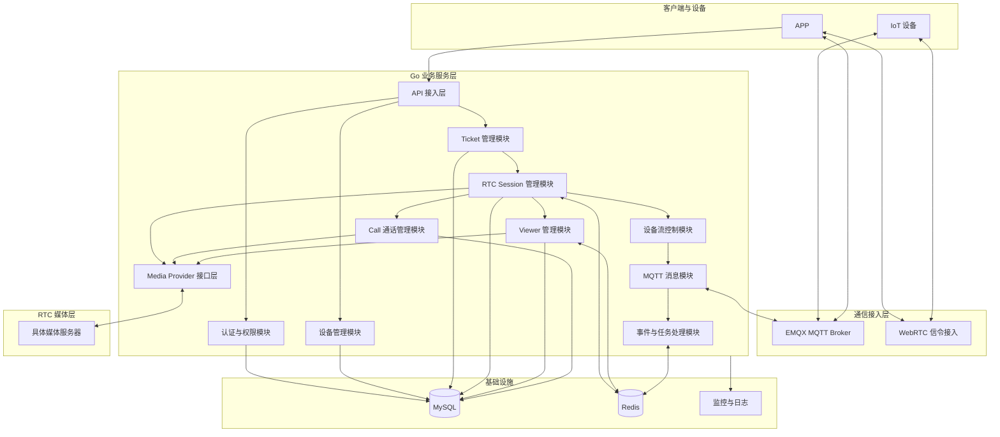
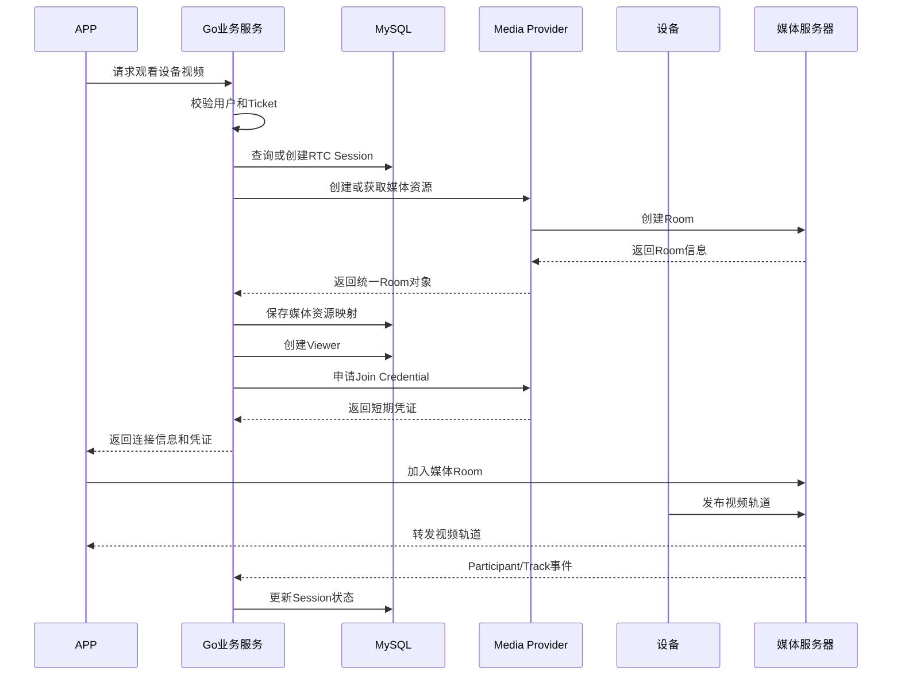
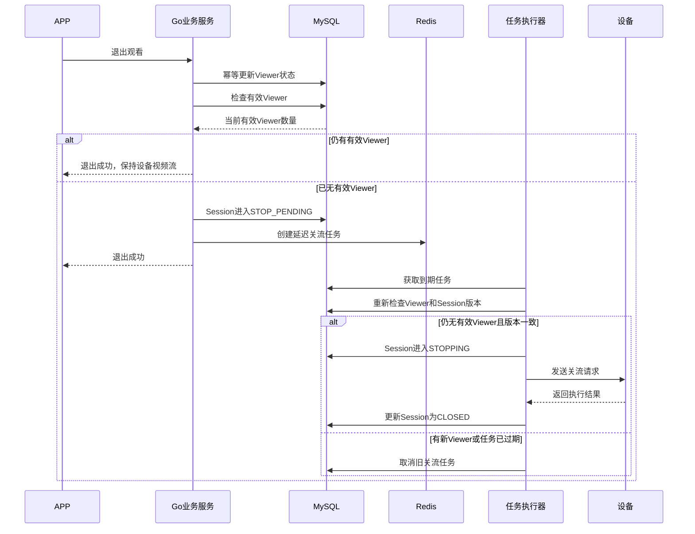
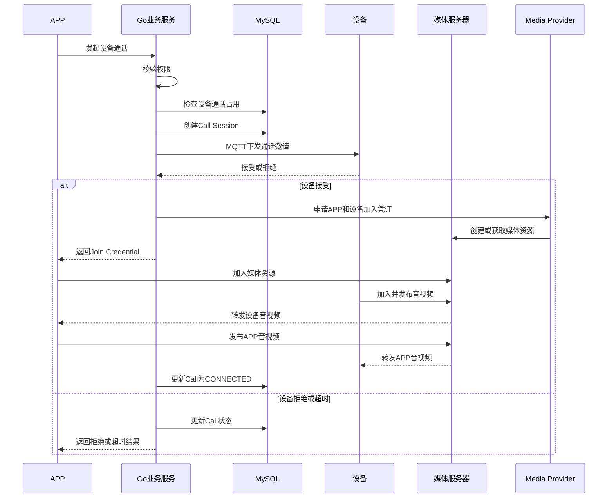

# 自研EMQX完整实施方案

**版本：** V1.0  
**建设目标：** 基于 EMQX 构建自研 IoT 服务端，实现 MQTT 设备接入、设备管理、WebRTC 实时音视频、设备视频观看、双向音视频通话及相关业务能力。  
**第一阶段设备规模：** 10,000 台  
**核心技术方向：** EMQX + Go + MySQL + Redis + WebRTC  
**RTC 媒体服务器策略：** 采用可插拔 Media Provider 架构，暂不绑定 LiveKit。

---

# 一、项目建设目标

## 1.1 建设背景

平台以 EMQX 为基础构建 MQTT 消息通信能力，在此基础上开发自有业务服务端，统一管理设备、用户、设备状态、消息通信、视频流控制以及 RTC 实时音视频业务。

系统需要同时满足两类通信需求：

1. **设备消息通信：** 通过 MQTT 实现设备上下线、属性上报、事件上报、服务端命令下发及命令响应。
2. **实时音视频通信：** 通过 WebRTC 实现 APP 对设备视频的单向观看，以及 APP 与设备之间的双向音视频通话。

系统需要具备较好的扩展能力。特别是 RTC 媒体服务器目前尚未最终选型，因此业务系统不能直接依赖某一个媒体服务器的 SDK、API 或数据结构。

## 1.2 第一阶段建设目标

第一阶段重点完成以下能力：

| 模块 | 建设内容 |
|---|---|
| 设备接入 | MQTT 设备认证、连接管理、设备上下线 |
| 设备管理 | 产品、设备、设备状态、设备信息管理 |
| MQTT 通信 | 属性上报、事件上报、命令下发、命令响应 |
| 用户与权限 | 用户身份、设备授权、访问控制 |
| Ticket 管理 | 设备视频访问票据的创建、校验、更新和失效 |
| RTC 会话 | 视频 Session、RTC Room、Participant 管理 |
| Viewer 管理 | 多用户、多客户端观看状态管理 |
| 视频控制 | 设备开流、关流、流状态管理 |
| 双向通话 | 通话申请、接听、拒绝、结束及冲突处理 |
| 媒体接入 | 可插拔 Media Provider 接口 |
| 状态管理 | MySQL 持久化、Redis 缓存与分布式协调 |
| 运维监控 | 日志、指标、链路追踪、告警 |

## 1.3 第一阶段暂不作为重点的内容

以下内容预留扩展能力，但不作为第一阶段的核心交付：

- 多家 RTC 媒体服务器同时运行及动态调度。
- 自研 SFU 媒体转发服务器。
- 大规模跨地域 RTC 媒体调度。
- 复杂的视频录制、转码和视频内容处理。
- 多设备之间的实时音视频会议。
- 复杂的设备端音视频能力协商平台。

---

# 二、总体技术架构

## 2.1 技术选型

| 层级 | 技术 | 主要职责 |
|---|---|---|
| MQTT 接入层 | EMQX | MQTT Broker、连接认证、ACL、消息路由 |
| 业务服务层 | Go | 设备管理、业务接口、权限、RTC 控制 |
| 关系型数据库 | MySQL | 业务数据、会话数据、关键状态持久化 |
| 缓存与协调层 | Redis | 缓存、分布式锁、短期状态、事件协调 |
| 实时音视频协议 | WebRTC | 设备与 APP 之间的实时音视频通信 |
| 媒体服务器层 | Media Provider | 对接具体 RTC 媒体服务器 |
| 监控系统 | Prometheus + Grafana | 指标采集、可视化和告警 |
| 日志系统 | 根据部署环境选型 | 日志收集、检索与问题追踪 |

### 技术选型原则

1. EMQX 负责 MQTT 通信基础设施，不将业务逻辑写入 EMQX 核心。
2. Go 负责业务控制和业务状态管理，不负责转发音视频媒体流。
3. MySQL 负责关键业务状态的持久化。
4. Redis 负责缓存和分布式协调，不作为唯一业务数据来源。
5. WebRTC 负责实时音视频传输。
6. Media Provider 隔离媒体服务器实现，避免业务模块与某个 RTC 产品绑定。

## 2.2 总体架构图



说明：

- APP 和设备通过 MQTT 与业务系统交互。
- APP 和设备通过 WebRTC 建立实际媒体连接。
- Go 服务端负责鉴权、会话管理、信令协调、设备流控制及媒体资源管理。
- 媒体数据不经过 Go 业务服务转发。
- 媒体服务器由 Media Provider 统一接入，具体实现后续选型。

## 2.3 控制平面与媒体平面分离

整个 RTC 系统分为两个部分。

**控制平面：**

由 Go 业务服务负责，包括：

- 用户身份认证。
- 设备访问权限校验。
- Ticket 校验。
- RTC Session 创建和销毁。
- Viewer 加入和退出。
- Call 通话状态管理。
- 媒体服务器资源创建和管理。
- 设备开流和关流指令。
- 媒体事件接收和状态同步。

**媒体平面：**

由具体媒体服务器负责，包括：

- WebRTC PeerConnection。
- ICE、STUN、TURN。
- DTLS、SRTP。
- 音视频轨道接收。
- 音视频转发。
- 多观看者媒体分发。
- 网络拥塞控制和媒体质量处理。

两者之间通过 Provider 接口交互。

业务服务只管理媒体资源，不承担音视频数据转发工作。

---

# 三、系统模块划分

第一阶段建议采用 Go 模块化单体架构。

即：所有业务模块先部署在同一个业务服务进程中，但代码结构、业务职责和数据访问边界清晰分离。

后续根据业务规模，再将 MQTT 消息服务、RTC 服务、设备管理服务等独立拆分。

## 3.1 API 接入模块

负责对外提供 HTTP API。

主要职责：

- 用户认证。
- 请求参数校验。
- 统一响应格式。
- 权限校验。
- 请求限流。
- 请求日志。
- API 版本管理。

API 层不直接实现复杂业务逻辑，而是调用对应业务模块。

## 3.2 用户与权限模块

主要职责：

- 用户身份认证。
- 用户与设备之间的授权关系。
- 用户是否具有设备观看权限。
- 用户是否具有设备通话权限。
- 设备访问权限校验。

权限校验必须在 Ticket 使用、Viewer 创建、Call 创建等关键操作中执行。

不能仅依靠 APP 是否持有某个 Ticket 来判断其具有完整业务权限。

## 3.3 设备管理模块

负责设备基础信息和运行状态管理。

主要数据：

- 产品信息。
- 设备信息。
- 设备认证信息。
- 设备 MQTT 连接状态。
- 设备属性。
- 设备事件。
- 设备能力信息。
- 设备最后在线时间。

需要明确：

**MQTT 在线状态和 RTC 在线状态是两种独立状态。**

设备 MQTT 在线不代表设备 WebRTC 已连接，也不代表设备已经成功发布视频轨道。

## 3.4 MQTT 消息模块

负责与 EMQX 进行通信。

主要职责：

- 设备连接认证。
- MQTT ACL 权限控制。
- 设备消息订阅。
- 消息接收。
- 消息分发。
- 命令下发。
- 命令响应处理。
- 消息幂等处理。
- 设备上下线事件处理。

建议统一消息结构：

```json
{
  "message_id": "unique-message-id",
  "device_id": "device-001",
  "timestamp": 1790000000000,
  "type": "property_report",
  "payload": {}
}
```

建议 Topic 结构：

```text
iot/{tenant_id}/{product_key}/{device_id}/property
iot/{tenant_id}/{product_key}/{device_id}/event
iot/{tenant_id}/{product_key}/{device_id}/command
iot/{tenant_id}/{product_key}/{device_id}/command_reply
iot/{tenant_id}/{product_key}/{device_id}/state
iot/{tenant_id}/{product_key}/{device_id}/rtc
```

具体 Topic 应根据设备端现有协议进行调整，不要求为了统一而强制修改已经稳定运行的设备协议。

### MQTT 消息处理要求

1. 对重要消息设置唯一 `message_id`。
2. 服务端对重复消息进行幂等处理。
3. 命令下发需要记录命令 ID、目标设备、发送时间和执行结果。
4. 重要业务操作不能仅依赖 MQTT QoS 作为业务成功保证。
5. 对于设备状态，区分最后一次上报状态和服务端推断状态。
6. 对于命令超时，提供超时处理和必要的重试机制。

---

# 四、RTC 核心业务设计

## 4.1 RTC 业务对象

RTC 业务建议拆分为以下核心对象：

| 对象 | 说明 |
|---|---|
| Device Ticket | 设备视频访问票据 |
| RTC Session | 一次业务层视频会话 |
| RTC Room | 媒体服务器中的房间资源 |
| Participant | 媒体服务器中的参与者 |
| Track | 音频或视频媒体轨道 |
| Viewer | 一次独立观看行为 |
| Call Session | 一次双向音视频通话 |
| Media Resource | 业务资源与媒体服务器资源之间的映射 |

需要特别区分：

**RTC Session 不等于 RTC Room。**

RTC Session 是业务概念，RTC Room 是媒体服务器资源。

业务 Session 可以映射到一个或多个媒体资源，具体映射方式由 Media Provider 实现决定。

不要在业务核心代码中直接使用 LiveKit Room、LiveKit Participant 等厂商概念。

## 4.2 Device Ticket 设计

Device Ticket 用于控制设备视频访问权限。

已经明确的业务规则：

1. 一个 Ticket 可以被多个用户使用。
2. 一个 Ticket 可以被多个 IP 使用。
3. 一个 Ticket 可以被多个客户端使用。
4. 不同清晰度的视频流不需要分别申请 Ticket。
5. 不同通道的视频流不需要分别申请 Ticket。
6. 换票后旧 Ticket 失效。
7. Ticket 不能直接等同于 RTC 媒体服务器的 Join Token。

建议 Ticket 表：

```sql
CREATE TABLE device_ticket (
    id BIGINT PRIMARY KEY AUTO_INCREMENT,
    ticket_id VARCHAR(64) NOT NULL UNIQUE,
    device_id VARCHAR(64) NOT NULL,
    status TINYINT NOT NULL,
    version INT NOT NULL DEFAULT 1,
    expire_at DATETIME NULL,
    created_at DATETIME NOT NULL,
    updated_at DATETIME NOT NULL,
    INDEX idx_device_id (device_id)
);
```

Ticket 校验至少包含：

- Ticket 是否存在。
- Ticket 是否有效。
- Ticket 是否过期。
- Ticket 是否已经被换票失效。
- 当前用户是否有权访问对应设备。
- 当前操作是否符合设备业务权限。

建议 Ticket 本身采用高强度随机值，不直接暴露数据库自增 ID。

### Ticket 与 RTC Join Credential 的关系

两者必须分离：

**Device Ticket：**

业务层长期或相对长期的访问凭证，可以由多个客户端共享。

**RTC Join Credential：**

每次客户端加入媒体房间时，由业务服务端单独签发的短期媒体访问凭证。

流程：

1. APP 提交 Device Ticket。
2. 服务端校验 Ticket。
3. 服务端校验用户和设备访问权限。
4. 服务端创建或获取 RTC Session。
5. 服务端通过 Media Provider 申请 Join Credential。
6. APP 使用 Join Credential 加入媒体服务器。

这样可以避免将业务 Ticket 直接交给媒体服务器使用。

换票后，旧 Ticket 不得再授权新的会话。已经签发的 RTC Join Credential 是否立即撤销，需要结合媒体服务器能力制定具体策略；不能假设业务 Ticket 失效会自动让所有已建立的媒体连接断开。

## 4.3 RTC Session 设计

RTC Session 是设备视频业务的核心对象。

建议 Session 业务维度：

```text
device_id
channel_id
stream_type
resolution
```

其中：

- `device_id`：设备 ID。
- `channel_id`：设备视频通道。
- `stream_type`：视频流类型。
- `resolution`：清晰度。

需要注意：这些字段是业务流的识别维度，不代表媒体服务器一定要为每个清晰度、每个通道创建独立 Room。

最终如何映射到媒体 Room 和 Track，要结合设备实际发布方式及媒体服务器能力决定。

Session 状态建议：

```text
CREATED
  |
  v
WAITING_DEVICE
  |
  v
STREAM_STARTING
  |
  v
ACTIVE
  |
  v
STOP_PENDING
  |
  v
STOPPING
  |
  v
CLOSED
```

异常状态可增加：

```text
FAILED
```

状态说明：

| 状态 | 含义 |
|---|---|
| CREATED | 业务 Session 已创建 |
| WAITING_DEVICE | 等待设备上线或响应 |
| STREAM_STARTING | 正在请求设备开流 |
| ACTIVE | 视频流已确认可用 |
| STOP_PENDING | 暂时没有观看者，等待延迟关闭 |
| STOPPING | 正在执行关流 |
| CLOSED | 会话已经关闭 |
| FAILED | 会话创建或运行失败 |

状态变化必须通过统一的状态机控制，不能由不同业务模块随意修改。

## 4.4 Viewer 管理设计

Viewer 表示一次独立的观看行为。

不能简单使用用户 ID 代表观看者，因为同一个用户可能：

- 在手机和电脑上同时观看。
- 在两个手机上同时观看。
- 同一个客户端重复进入和退出。
- 网络断开后重新连接。

建议 Viewer 唯一标识：

```text
viewer_id
session_id
user_id
client_id
status
joined_at
last_heartbeat_at
left_at
```

建议 Viewer 状态：

```text
JOINING
  |
  v
ACTIVE
  |
  v
LEAVING
  |
  v
LEFT
```

异常断开可以进入：

```text
DISCONNECTED
```

Viewer 的加入和退出必须幂等。

同一个 Viewer 重复执行退出操作，不应该导致重复扣减观看人数或重复触发设备关流。

### Viewer 心跳与过期

需要设计 Viewer 心跳机制。

例如：

- APP 定期向服务端发送心跳。
- 服务端更新 Viewer 最近活跃时间。
- 超过设定时间未收到心跳，进入过期处理。
- 结合媒体服务器 Participant 状态进行二次确认。

心跳周期、超时时间和媒体断线容忍时间应通过实际网络环境测试确定，不应直接把示例值作为最终生产配置。

### 最后一个 Viewer 退出后的处理

这是整个视频流管理中最重要的业务规则之一。

**单个 Viewer 退出不能直接关闭设备视频流。**

只有最后一个有效 Viewer 退出后，才允许进入设备关流流程。

建议流程：

1. Viewer 退出。
2. 服务端幂等更新 Viewer 状态。
3. 重新统计当前有效 Viewer。
4. 如果仍有有效 Viewer，保持视频流。
5. 如果没有有效 Viewer，Session 进入 `STOP_PENDING`。
6. 创建延迟关流任务。
7. 延迟时间到达后重新检查 Viewer。
8. 如果仍然没有有效 Viewer，进入 `STOPPING`。
9. 调用设备流控制模块执行关流。
10. 确认设备和媒体状态后，将 Session 标记为 `CLOSED`。

延迟关流可以设置成可配置参数，例如 30 秒，但最终值需要根据业务体验和设备资源情况决定。

### 为什么不能直接使用 viewer_count

`viewer_count` 可以用于展示和快速判断，但不能作为唯一关流依据。

原因：

- 多实例并发加入和退出。
- 网络断开造成退出事件丢失。
- 客户端重复提交退出请求。
- Redis 数据过期或服务重启。
- 媒体服务器与业务服务状态短暂不一致。

建议采用：

- Viewer 明细作为业务判断依据。
- Redis 原子操作或事务脚本保证并发协调。
- MySQL 唯一约束和持久化状态保证业务一致性。
- 延迟任务执行前重新检查有效 Viewer。
- 定时对账修复异常状态。

不能只依靠 Go 进程中的 `time.Sleep` 或单机定时器实现延迟关流，因为服务重启后任务会丢失。

---

# 五、设备视频流控制设计

## 5.1 设备流控制职责

设备流控制模块负责将业务层的开流、关流请求转换成设备可以执行的具体指令。

它不应该直接写入 RTC Session 业务逻辑中。

建议定义统一接口：

```go
type DeviceStreamController interface {
    StartStream(
        ctx context.Context,
        req StartStreamRequest,
    ) error

    StopStream(
        ctx context.Context,
        req StopStreamRequest,
    ) error

    GetStreamStatus(
        ctx context.Context,
        req GetStreamStatusRequest,
    ) (*StreamStatus, error)
}
```

具体请求结构：

```go
type StartStreamRequest struct {
    DeviceID   string
    ChannelID  string
    StreamType string
    Resolution string
    SessionID  string
    RequestID  string
}

type StopStreamRequest struct {
    DeviceID  string
    ChannelID string
    SessionID string
    RequestID string
}

type StreamStatus struct {
    DeviceID  string
    SessionID string
    Active    bool
}
```

## 5.2 为什么需要独立的设备流控制接口

目前设备视频流的启动和关闭方式还需要结合设备端协议确认。

可能存在以下情况：

1. 通过 MQTT 下发指令启动设备视频流。
2. 设备收到 WebRTC 信令后自动启动视频发布。
3. 设备有独立的启动流、关闭流接口。
4. 设备视频流由外部平台控制。

如果把具体控制方式写死在 RTC Session 模块中，后续协议变化会影响大量业务代码。

通过 `DeviceStreamController` 可以将差异隔离。

第一阶段先实现实际设备协议对应的 Controller；尚未确定的控制方式，通过接口和配置预留，不提前实现不存在的业务行为。

## 5.3 设备流控制幂等

开流和关流必须具备幂等能力。

例如：

- 相同 Session 重复请求开流，不应产生多个互相冲突的开流任务。
- 相同 Session 重复请求关流，不应产生重复副作用。
- 关流过程中有新 Viewer 加入，需要阻止旧关流任务误关新会话。
- 设备回复延迟或乱序时，不能直接覆盖较新的业务状态。

每次控制请求建议带上：

```text
request_id
session_id
device_id
operation
created_at
```

设备端如果支持，也应回传 `request_id`，以便准确关联响应。

---

# 六、双向音视频通话设计

## 6.1 业务模式

系统需要支持两种 RTC 业务模式：

### 模式 A：APP 单向观看设备视频

```text
设备
  |
  | 发布视频轨道
  v
媒体服务器
  |
  | 转发视频轨道
  v
APP
```

设备作为 Publisher，APP 作为 Subscriber。

APP 只需要订阅设备视频，不需要发布自己的音视频轨道。

### 模式 B：APP 与设备双向音视频通话

```text
APP <----------> 媒体服务器 <----------> 设备
       音视频轨道双向发布与订阅
```

APP 和设备根据自身硬件能力发布音视频轨道，并订阅对方的轨道。

设备是否具备麦克风、扬声器、摄像头等能力，需要通过设备能力信息进行判断。

## 6.2 Call Session

双向通话建议独立于普通观看 Session 管理。

建议 Call Session 包含：

```text
call_id
device_id
caller_user_id
session_id
status
started_at
answered_at
ended_at
end_reason
```

建议状态：

```text
CREATED
  |
  v
RINGING
  |
  +------> REJECTED
  |
  +------> TIMEOUT
  |
  v
ACCEPTED
  |
  v
CONNECTED
  |
  v
ENDED
```

异常情况下可以进入 `FAILED`。

## 6.3 通话冲突处理

第一阶段建议：

**同一设备同一时间只允许存在一个主通话。**

如果已有主通话：

- 其他用户不能直接抢占设备麦克风。
- 可以根据权限允许其他用户继续观看设备视频。
- 新通话请求返回设备忙状态。
- 原通话结束后，才允许新的通话请求。

该规则需要通过数据库唯一约束或可靠的分布式协调机制保证，不能只在某个 Go 实例中判断。

## 6.4 通话与普通观看的关系

通话和普通观看需要明确资源关系。

建议：

- 普通 Viewer 负责观看行为。
- Call Session 负责通话行为。
- 设备视频流可以被普通观看和通话共同使用，但必须以设备实际发布能力为准。
- 通话结束不应该无条件关闭仍被其他 Viewer 使用的视频流。
- 通话结束时只释放属于本次 Call 的资源。

---

# 七、Media Provider 可插拔架构

## 7.1 设计目标

RTC 媒体服务器尚未最终确定。

系统需要做到：

1. 业务模块不直接依赖具体媒体服务器 SDK。
2. 业务数据不直接保存厂商专属对象作为核心状态。
3. 更换媒体服务器时，主要修改 Provider Adapter。
4. 设备端和 APP 端可以针对不同媒体服务器实现各自的信令适配。
5. 允许未来支持多个媒体服务器，但第一阶段只运行一个 Provider。

需要明确：

**可插拔不代表不同媒体服务器可以零成本切换。**

媒体服务器之间的信令、SDK、凭证、媒体能力和设备端兼容性可能存在差异。因此，Provider 解决的是服务端业务耦合问题，客户端兼容性仍然需要单独适配。

## 7.2 架构结构

```text
RTC 业务模块
    |
    v
Media Provider Interface
    |
    +----------------------+
    |                      |
    v                      v
LiveKit Adapter       Other Adapter
    |                      |
    v                      v
LiveKit Server         Other Media Server
```

第一阶段不需要提前实现多个 Adapter，只需要定义接口并完成一个选定媒体服务器的 PoC 和 Adapter。

## 7.3 Provider 核心接口

建议先定义最小通用接口：

```go
type MediaProvider interface {
    CreateRoom(
        ctx context.Context,
        req CreateRoomRequest,
    ) (*Room, error)

    DeleteRoom(
        ctx context.Context,
        roomID string,
    ) error

    CreateJoinCredential(
        ctx context.Context,
        req JoinRequest,
    ) (*JoinCredential, error)

    RemoveParticipant(
        ctx context.Context,
        req RemoveParticipantRequest,
    ) error

    GetRoom(
        ctx context.Context,
        roomID string,
    ) (*Room, error)

    GetParticipant(
        ctx context.Context,
        roomID string,
        identity string,
    ) (*Participant, error)

    GetTracks(
        ctx context.Context,
        roomID string,
        identity string,
    ) ([]Track, error)
}
```

基础请求和响应：

```go
type CreateRoomRequest struct {
    SessionID string
    RoomName  string
}

type JoinRequest struct {
    RoomID       string
    Identity     string
    DisplayName  string
    CanPublish   bool
    CanSubscribe bool
    ExpiresAt    time.Time
}

type JoinCredential struct {
    Token     string
    ExpiresAt time.Time
    ServerURL string
}

type Room struct {
    ID        string
    Name      string
    CreatedAt time.Time
}

type Participant struct {
    Identity string
    JoinedAt time.Time
    State    string
}

type Track struct {
    ID        string
    Kind      string
    Source    string
    Published bool
}
```

说明：

- 上述结构是业务层统一模型。
- 具体 Adapter 将厂商返回的数据转换成统一模型。
- 厂商专属参数不要无限堆积在通用接口中。
- 对于通用接口无法覆盖的高级能力，可以设计独立扩展接口或 Provider Capability。

## 7.4 Provider 能力声明

不同媒体服务器支持的能力不一定完全相同。

建议增加能力描述：

```go
type MediaCapabilities struct {
    SupportsAudio      bool
    SupportsVideo      bool
    SupportsDataTrack  bool
    SupportsE2EE       bool
    SupportsRecording  bool
    SupportsSimulcast  bool
    SupportsMultiTrack bool
}
```

Provider 初始化后向业务系统报告能力。

业务模块根据能力判断是否允许某种业务操作，避免调用一个媒体服务器不支持的功能。

## 7.5 媒体资源映射

业务 Session 与媒体服务器资源之间需要建立独立映射表。

建议：

```sql
CREATE TABLE rtc_media_resource (
    id BIGINT PRIMARY KEY AUTO_INCREMENT,
    session_id VARCHAR(64) NOT NULL,
    provider VARCHAR(32) NOT NULL,
    resource_type VARCHAR(32) NOT NULL,
    provider_resource_id VARCHAR(128) NOT NULL,
    status TINYINT NOT NULL,
    created_at DATETIME NOT NULL,
    updated_at DATETIME NOT NULL,
    UNIQUE KEY uk_provider_resource (
        provider,
        resource_type,
        provider_resource_id
    ),
    INDEX idx_session_id (session_id)
);
```

不要把媒体服务器的 Room ID 直接当成业务 Session ID。

也不要在业务表中到处保存厂商专属字段。

如果后续需要记录 Participant、Track 等映射，可以扩展为独立的 Participant/Track 资源映射表，或在资源表中增加明确的资源类型和关联字段。

## 7.6 Provider 配置

建议配置：

```yaml
media:
  provider: "your_provider"

  providers:
    your_provider:
      endpoint: "https://media.example.com"
      api_key: "${MEDIA_API_KEY}"
      api_secret: "${MEDIA_API_SECRET}"

  credential:
    default_ttl_seconds: 300
```

其中 `your_provider` 只是配置占位符，不代表当前已经确定具体产品。

服务启动时根据配置创建对应 Provider：

```go
func NewMediaProvider(cfg MediaConfig) (MediaProvider, error) {
    switch cfg.Provider {
    case "your_provider":
        return NewYourProvider(cfg.Providers.YourProvider)

    default:
        return nil, fmt.Errorf(
            "unsupported media provider: %s",
            cfg.Provider,
        )
    }
}
```

生产环境建议启动时检查配置、密钥和服务连通性，配置错误应明确失败，不能静默降级到其他媒体服务器。

## 7.7 媒体事件统一化

媒体服务器可能通过 Webhook、WebSocket 或其他方式向业务系统通知事件。

建议统一转换成业务事件：

```go
type MediaEvent struct {
    EventID    string
    Provider   string
    EventType  string
    SessionID  string
    RoomID     string
    Identity   string
    TrackID    string
    OccurredAt time.Time
    Payload    []byte
}
```

业务事件示例：

```text
media.participant_joined
media.participant_left
media.track_published
media.track_unpublished
media.room_closed
media.connection_failed
```

处理要求：

- 校验事件来源。
- 校验签名或使用可靠的认证机制。
- 根据 `EventID` 实现幂等。
- 允许事件重复投递。
- 允许事件乱序。
- 不允许旧事件覆盖更新的业务状态。
- 重要事件处理失败后可以重试。

---

# 八、数据库设计

第一阶段建议采用 MySQL 作为业务主数据库。

以下是核心表设计方向，不代表最终全部字段必须一次性实现。

## 8.1 设备相关表

### device

```text
id
device_id
product_id
device_name
status
mqtt_status
rtc_status
last_online_at
created_at
updated_at
```

### product

```text
id
product_key
product_name
protocol
created_at
updated_at
```

### device_capability

```text
id
device_id
capability_type
capability_value
updated_at
```

设备能力可以用于描述：

- 视频能力。
- 音频能力。
- 通道数量。
- 清晰度支持。
- WebRTC 能力。
- 是否支持双向音视频。

## 8.2 Ticket 表

使用前文 `device_ticket` 作为基础。

建议增加 Ticket 的创建者、失效时间、换票版本和审计记录。

如果一个设备同时存在多个历史 Ticket，必须确保只有当前有效版本能够授权新的业务会话。

## 8.3 RTC Session 表

```sql
CREATE TABLE rtc_session (
    id BIGINT PRIMARY KEY AUTO_INCREMENT,
    session_id VARCHAR(64) NOT NULL UNIQUE,
    device_id VARCHAR(64) NOT NULL,
    channel_id VARCHAR(64) NOT NULL,
    stream_type VARCHAR(32) NOT NULL,
    resolution VARCHAR(32) DEFAULT NULL,
    status VARCHAR(32) NOT NULL,
    generation BIGINT NOT NULL DEFAULT 1,
    started_at DATETIME NULL,
    closed_at DATETIME NULL,
    created_at DATETIME NOT NULL,
    updated_at DATETIME NOT NULL,
    INDEX idx_device_status (device_id, status)
);
```

`generation` 用于区分同一业务资源不同轮次的流会话，避免旧任务误操作新会话。

## 8.4 Viewer 表

```sql
CREATE TABLE rtc_viewer (
    id BIGINT PRIMARY KEY AUTO_INCREMENT,
    viewer_id VARCHAR(64) NOT NULL UNIQUE,
    session_id VARCHAR(64) NOT NULL,
    user_id VARCHAR(64) NOT NULL,
    client_id VARCHAR(64) NOT NULL,
    status VARCHAR(32) NOT NULL,
    joined_at DATETIME NULL,
    last_heartbeat_at DATETIME NULL,
    left_at DATETIME NULL,
    created_at DATETIME NOT NULL,
    updated_at DATETIME NOT NULL,
    INDEX idx_session_status (session_id, status),
    INDEX idx_user_id (user_id)
);
```

如果需要支持同一用户在不同设备同时观看，应保证每次观看行为都有独立 `viewer_id`。

## 8.5 Call 表

```sql
CREATE TABLE rtc_call (
    id BIGINT PRIMARY KEY AUTO_INCREMENT,
    call_id VARCHAR(64) NOT NULL UNIQUE,
    device_id VARCHAR(64) NOT NULL,
    caller_user_id VARCHAR(64) NOT NULL,
    session_id VARCHAR(64) DEFAULT NULL,
    status VARCHAR(32) NOT NULL,
    started_at DATETIME NULL,
    answered_at DATETIME NULL,
    ended_at DATETIME NULL,
    end_reason VARCHAR(64) DEFAULT NULL,
    created_at DATETIME NOT NULL,
    updated_at DATETIME NOT NULL,
    INDEX idx_device_status (device_id, status)
);
```

同一设备主通话唯一性，必须通过数据库约束、事务或独立的设备通话占用记录实现，不能只依赖查询后判断。

## 8.6 任务表

建议增加业务任务表，用于管理延迟关流、设备控制重试、状态对账等任务。

核心字段：

```text
id
task_id
task_type
business_id
generation
status
execute_at
retry_count
last_error
created_at
updated_at
```

任务执行前必须重新读取业务状态，并检查任务对应的 `generation` 是否仍然有效。

---

# 九、Redis 与并发控制设计

## 9.1 Redis 使用范围

Redis 主要承担：

- 设备在线状态缓存。
- Session 状态缓存。
- Viewer 活跃状态缓存。
- 分布式协调。
- 短期业务锁。
- 延迟任务辅助索引。
- 消息去重辅助数据。

关键业务数据仍然以 MySQL 为准。

## 9.2 并发控制原则

所有涉及资源占用、Viewer 加入退出、通话占用、设备开关流的操作，都需要考虑多实例并发。

典型并发场景：

1. 两个 APP 同时申请观看同一设备。
2. 最后一个 Viewer 退出时，另一个 Viewer 同时加入。
3. 两个用户同时申请同一设备通话。
4. 设备开流响应和 APP 退出请求同时到达。
5. 旧关流任务执行时，新一轮 Session 已经创建。

这些问题不能只通过 Go 进程内的 Mutex 解决。

## 9.3 状态修改方式

建议采用以下组合：

- MySQL 事务处理关键业务状态。
- 唯一索引防止重复业务资源。
- 乐观锁或版本号控制并发更新。
- Redis Lua 或其他原子操作实现需要快速协调的操作。
- 分布式锁用于跨实例互斥场景。
- 幂等键防止重复请求。
- 定时任务进行状态对账。

### 特别注意：可变状态不能在多个协程中无保护地共享

例如某个业务对象中的 `wrote` 状态，如果多个 Goroutine 同时读取和修改，就可能产生数据竞争。

解决方式应根据业务语义选择：

- 使用互斥锁保护。
- 使用原子变量。
- 使用单协程事件循环。
- 使用数据库版本号。
- 使用 Redis 原子操作。

不能仅仅因为变量是 `bool` 就认为并发读写安全。

对于跨实例的业务状态，Go 的 Mutex 也无法解决问题。

---

# 十、核心业务流程

## 10.1 APP 观看设备视频流程



具体执行时，设备是否需要先收到 MQTT 开流指令，要由设备协议决定。

如果设备必须先开流，则在设备流控制成功或确认设备发布媒体后，再将 Session 更新为 `ACTIVE`。

不能仅因为 API 已经返回 Join Credential，就认为视频已经可观看。

## 10.2 Viewer 退出与延迟关流流程



重要要求：

- 延迟任务必须持久化。
- 任务必须幂等。
- 执行任务前必须重新检查 Viewer。
- 必须检查 Session `generation`。
- 新 Viewer 加入时，需要取消或使旧任务失效。
- 不能让旧任务关闭新一轮视频流。

## 10.3 双向通话流程



实际设备邀请方式、设备是否需要单独加入媒体房间、媒体资源复用方式，均需要通过设备端联调确定。

---

# 十一、对外 API 设计

第一阶段建议使用 REST API 提供业务能力。

以下为建议接口，不是最终接口协议。

## 11.1 设备接口

```text
POST   /api/v1/devices
GET    /api/v1/devices/{device_id}
GET    /api/v1/devices/{device_id}/status
GET    /api/v1/devices/{device_id}/capabilities
```

## 11.2 Ticket 接口

```text
POST   /api/v1/devices/{device_id}/ticket
GET    /api/v1/devices/{device_id}/ticket
POST   /api/v1/devices/{device_id}/ticket/renew
```

## 11.3 视频观看接口

```text
POST   /api/v1/rtc/sessions
POST   /api/v1/rtc/sessions/{session_id}/viewers
DELETE /api/v1/rtc/sessions/{session_id}/viewers/{viewer_id}
POST   /api/v1/rtc/viewers/{viewer_id}/heartbeat
GET    /api/v1/rtc/sessions/{session_id}
```

## 11.4 通话接口

```text
POST   /api/v1/rtc/calls
POST   /api/v1/rtc/calls/{call_id}/accept
POST   /api/v1/rtc/calls/{call_id}/reject
POST   /api/v1/rtc/calls/{call_id}/hangup
GET    /api/v1/rtc/calls/{call_id}
```

## 11.5 媒体事件接口

```text
POST   /api/v1/internal/media/events
```

该接口仅用于媒体服务器事件回调，不对普通用户开放。

需要校验事件来源、签名、时间戳和事件唯一 ID。

---

# 十二、项目代码结构

第一阶段建议使用如下 Go 项目结构：

```text
iot-server/
├── cmd/
│   └── server/
│       └── main.go
│
├── internal/
│   ├── api/
│   │   ├── handler/
│   │   ├── middleware/
│   │   └── router/
│   │
│   ├── auth/
│   │
│   ├── device/
│   │   ├── model/
│   │   ├── repository/
│   │   ├── service/
│   │   └── controller/
│   │
│   ├── mqtt/
│   │   ├── client/
│   │   ├── auth/
│   │   ├── acl/
│   │   ├── handler/
│   │   └── message/
│   │
│   ├── ticket/
│   │
│   ├── rtc/
│   │   ├── session/
│   │   ├── viewer/
│   │   ├── call/
│   │   ├── stream/
│   │   ├── media/
│   │   │   ├── provider.go
│   │   │   ├── types.go
│   │   │   ├── factory.go
│   │   │   └── adapters/
│   │   └── event/
│   │
│   ├── task/
│   │
│   ├── repository/
│   │
│   └── infrastructure/
│       ├── mysql/
│       ├── redis/
│       ├── emqx/
│       └── logger/
│
├── migrations/
├── configs/
├── deployments/
├── scripts/
├── docs/
├── go.mod
└── README.md
```

### 代码分层要求

建议统一采用：

```text
Handler
   |
   v
Service
   |
   v
Repository
   |
   v
MySQL / Redis
```

其中：

- Handler 处理 HTTP 请求和响应。
- Service 实现业务规则。
- Repository 负责数据访问。
- Infrastructure 提供基础设施客户端。
- Provider Adapter 负责媒体服务器适配。

禁止 Handler 直接写复杂 SQL 或操作媒体服务器 SDK。

禁止 Session 模块直接调用某个厂商的 API。

---

# 十三、部署架构

## 13.1 第一阶段部署原则

第一阶段以稳定、便于维护为优先。

建议部署组件：

```text
                APP / IoT设备
                     |
          +----------+----------+
          |                     |
       MQTT连接              HTTP/RTC信令
          |                     |
       EMQX集群             Go业务服务
                                |
              +-----------------+----------------+
              |                 |                |
            MySQL             Redis         Media Provider
                                                  |
                                             媒体服务器
```

建议初期部署：

- EMQX：独立部署。
- Go 业务服务：至少预留多实例部署能力。
- MySQL：独立部署，配置备份。
- Redis：独立部署。
- 媒体服务器：单独部署或使用托管服务，具体取决于后续选型。
- 监控与日志：独立部署或接入现有平台。

## 13.2 多实例部署要求

Go 业务服务必须从第一版开始支持多实例运行。

不能依赖：

- 单机内存中的 Viewer 列表。
- 单机内存中的 Session 状态。
- 单机定时器。
- 进程内 Mutex 作为全局业务锁。
- 单实例 MQTT 消息处理假设。

所有跨实例共享状态必须放在 MySQL、Redis 或可靠消息系统中。

## 13.3 容量规划

第一阶段目标是 10,000 台设备，但不能直接据此推导 RTC 媒体服务器规模。

需要分别评估：

| 指标 | 需要评估的内容 |
|---|---|
| MQTT 连接数 | 设备和 APP 的连接总量 |
| MQTT 消息量 | 每秒上报消息数量 |
| RTC 发布数 | 同时发布音视频的设备数量 |
| RTC 订阅数 | APP 观看连接数量 |
| 媒体带宽 | 上行、下行和转发总带宽 |
| TURN 比例 | 需要 TURN 中继的连接比例 |
| 通话并发 | 同时进行双向通话的设备数量 |
| 媒体质量 | 分辨率、帧率、码率和丢包情况 |

媒体服务器的成本和容量，主要取决于实际媒体并发和带宽，而不是设备总数。

正式部署前必须进行压测，不能只依据设备注册数量估算资源。

---

# 十四、安全设计

## 14.1 MQTT 安全

- 每台设备必须具备独立身份。
- 设备认证信息不能在设备之间共享。
- ACL 必须限制设备只能访问自身允许的 Topic。
- 重要指令需要校验设备身份和业务权限。
- 生产环境优先采用 TLS。
- 认证信息需要支持轮换。

## 14.2 RTC 安全

- Device Ticket 不直接作为媒体服务器 Join Token。
- Join Credential 使用短期有效期。
- 服务端签发凭证前必须完成业务权限校验。
- 限制 Participant 的发布和订阅权限。
- 媒体事件回调必须校验来源。
- 设备和 APP 的身份必须与业务身份关联。
- 对异常加入、频繁重连和非法媒体发布行为进行监控。

## 14.3 API 安全

- 用户身份认证。
- 设备访问授权。
- 接口限流。
- 请求签名或适当的防重放机制。
- 敏感字段脱敏。
- 密钥统一管理。
- 内部接口隔离。

---

# 十五、监控与异常恢复

## 15.1 MQTT 监控

建议监控：

- 当前 MQTT 连接数。
- 设备在线数量。
- 连接失败次数。
- 消息收发速率。
- 消息处理延迟。
- 消息积压。
- 命令超时数量。
- 设备异常断开次数。

## 15.2 RTC 监控

建议监控：

- RTC Session 数量。
- Viewer 数量。
- Call 数量。
- Participant 数量。
- 视频 Track 数量。
- 媒体连接成功率。
- ICE 连接成功率。
- 媒体连接建立耗时。
- 媒体断开次数。
- 设备发布轨道成功率。
- 视频首帧耗时。
- 音视频丢包和延迟。
- TURN 中继比例。
- 媒体服务器 CPU、内存和网络带宽。

## 15.3 业务异常恢复

需要设计定时对账任务：

1. 检查长时间处于 `WAITING_DEVICE` 的 Session。
2. 检查长时间处于 `STREAM_STARTING` 的 Session。
3. 检查 Viewer 心跳超时。
4. 检查媒体服务器 Participant 与业务 Viewer 是否一致。
5. 检查没有有效 Viewer 但仍在运行的设备视频流。
6. 检查已经关闭但媒体资源仍然存在的 Session。
7. 检查超时未完成的设备开关流任务。
8. 检查长期处于异常状态的 Call。

对账任务应具备：

- 可重复执行。
- 幂等处理。
- 执行日志。
- 失败重试。
- 最大重试次数。
- 人工干预能力。

对账不是替代正常业务流程，而是用于修复网络异常、进程重启、事件丢失等情况下产生的状态不一致。

---

# 十六、测试方案

## 16.1 单元测试

重点测试：

- Ticket 有效性判断。
- Ticket 换票逻辑。
- Session 状态机。
- Viewer 加入和退出。
- Viewer 幂等处理。
- 延迟关流判断。
- Call 状态机。
- 通话冲突处理。
- Provider 接口参数转换。
- 设备流控制幂等。

## 16.2 并发测试

重点测试以下场景：

### 场景一：多个 Viewer 同时加入

多个 APP 同时申请观看同一设备，最终应该只有一个符合业务规则的 Session，所有 Viewer 都能正确关联到该 Session。

### 场景二：最后一个 Viewer 退出时新 Viewer 加入

旧关流任务不能误关新 Viewer 正在使用的视频流。

### 场景三：重复退出

同一个 Viewer 重复退出，不应造成 Viewer 数量错误或重复关流。

### 场景四：两个用户同时发起通话

同一设备只能成功创建一个主通话。

### 场景五：设备开流响应延迟

设备返回旧请求的响应时，不能覆盖新一轮 Session 状态。

### 场景六：服务重启

服务重启后，未执行的延迟关流任务仍然能够恢复执行。

### 场景七：媒体服务器断线

媒体服务器异常时，业务系统能够识别异常状态，并提供重连、资源清理和状态对账能力。

## 16.3 集成测试

需要至少验证：

- APP MQTT 接入。
- 设备 MQTT 接入。
- 设备属性和事件上报。
- MQTT 命令下发和响应。
- APP 单向观看设备视频。
- 多 APP 同时观看。
- Viewer 退出和最后一个 Viewer 关流。
- 设备断网恢复。
- APP 网络切换恢复。
- 双向音视频通话。
- 通话冲突。
- Ticket 换票。
- 媒体服务器异常恢复。

## 16.4 压力测试

建议分阶段压测：

1. 10,000 台设备 MQTT 长连接。
2. 设备周期性属性上报。
3. 高频 MQTT 消息处理。
4. 多 Viewer 同时观看。
5. RTC 媒体发布与订阅并发。
6. 多实例下 Session 和 Viewer 并发操作。
7. 大量设备同时上下线。
8. 大量媒体连接重连。

最终容量指标应通过真实设备、真实网络和目标媒体服务器测试获得。

---

# 十七、分阶段实施计划

建议按照以下阶段实施，先保证基础链路，再逐步完成 RTC 业务。

## 阶段一：基础工程与设备接入

**目标：** 建立可运行的 Go 服务端和 MQTT 设备接入能力。

实施内容：

- 搭建 Go 项目结构。
- 接入 MySQL。
- 接入 Redis。
- 部署 EMQX。
- 完成设备认证。
- 完成 MQTT ACL。
- 完成设备上下线管理。
- 完成属性上报和事件上报。
- 完成命令下发和命令响应。
- 建立日志和监控基础能力。

交付结果：

- 设备能够稳定连接 EMQX。
- 服务端能够识别设备身份。
- 服务端能够接收和处理设备消息。
- 服务端能够向设备下发命令。

## 阶段二：RTC 业务基础

**目标：** 建立与媒体服务器无关的 RTC 业务模型。

实施内容：

- Ticket 模块。
- RTC Session 模块。
- Viewer 模块。
- Call 模块。
- Session 状态机。
- Viewer 心跳。
- 延迟关流任务。
- 设备流控制接口。
- Media Provider 接口。
- Media Resource 映射。
- 统一 Media Event 模型。

交付结果：

- RTC 核心业务对象和状态机已经建立。
- 业务模块不依赖具体媒体服务器。
- 设备开关流方式已经通过接口隔离。

## 阶段三：媒体服务器 PoC 与接入

**目标：** 选择实际媒体服务器并完成第一个 Provider Adapter。

候选方案可以包括：

- LiveKit 自部署版本。
- Janus。
- mediasoup。
- 其他满足设备 WebRTC 兼容要求的媒体服务器。

PoC 必须使用真实设备端和 APP 端进行验证。

验证内容：

1. 设备能否成功建立 WebRTC 连接。
2. 设备能否发布视频轨道。
3. APP 能否订阅设备视频。
4. 多个 APP 能否同时观看。
5. APP 和设备能否双向发布音视频。
6. 设备网络切换后能否恢复。
7. 媒体服务器是否支持业务需要的 Participant 管理。
8. 媒体事件是否能够可靠回调。
9. 部署和运维是否符合项目要求。
10. 带宽、CPU、内存和并发能力是否满足目标。

交付结果：

- 完成媒体服务器选型。
- 完成第一个 Media Provider Adapter。
- 完成设备和 APP 的媒体接入。
- 形成媒体服务器部署和运维文档。

## 阶段四：视频观看与通话业务

**目标：** 完成完整业务闭环。

实施内容：

- APP 观看设备视频。
- 多用户、多客户端观看。
- Viewer 心跳。
- Viewer 退出。
- 最后一个 Viewer 延迟关流。
- Ticket 换票。
- 双向音视频通话。
- 通话冲突控制。
- 设备异常离线处理。
- 媒体异常恢复。

交付结果：

- 单向观看业务稳定运行。
- 多 Viewer 业务稳定运行。
- 双向音视频通话可用。
- 设备流控制符合业务规则。

## 阶段五：性能、安全和生产部署

**目标：** 达到第一阶段正式上线要求。

实施内容：

- 10,000 台 MQTT 设备连接压测。
- RTC 媒体并发压测。
- Redis 和 MySQL 性能测试。
- 多实例部署。
- 服务故障恢复。
- 设备异常恢复。
- 安全测试。
- 监控告警。
- 数据备份。
- 灰度发布。
- 生产部署文档。

交付结果：

- 完成上线验收。
- 完成容量评估。
- 完成部署和运维手册。
- 具备故障排查和恢复能力。

---

# 十八、需要尽早确认的关键事项

以下事项会直接影响实现细节，应在对应开发阶段前确认。

| 事项 | 当前状态 | 对实现的影响 |
|---|---|---|
| 设备 WebRTC SDK | 待确认 | 决定信令、媒体连接和设备端适配方式 |
| 设备是否支持双向音频 | 待确认 | 决定通话能力 |
| 设备开流方式 | 待确认 | 决定 DeviceStreamController 实现 |
| 是否有独立启动流接口 | 待确认 | 决定设备流控制流程 |
| 设备多通道发布方式 | 待确认 | 决定 Session 与 Track 映射 |
| 设备多清晰度发布方式 | 待确认 | 决定媒体资源和订阅策略 |
| 媒体服务器 | 暂不确定 | 通过 PoC 选型 |
| STUN/TURN 部署 | 待确认 | 影响网络穿透和媒体带宽成本 |
| 视频录制需求 | 暂不纳入第一阶段 | 影响媒体服务器能力选择 |
| 设备和 APP 信令方式 | 待联调 | 影响客户端适配层 |
| Ticket 换票后的已连接会话处理 | 待确认 | 决定旧会话是否主动断开 |
| Viewer 心跳与超时阈值 | 待压测 | 影响异常断线和关流时机 |

## 18.1 RTC 媒体服务器选型原则

不要仅根据媒体服务器是否开源来选型。

建议重点比较：

- 设备端 WebRTC SDK 兼容性。
- APP 端 SDK 兼容性。
- 单向观看能力。
- 双向音视频能力。
- 多 Viewer 转发能力。
- 网络穿透能力。
- TURN 支持情况。
- 多实例部署方式。
- 监控和运维能力。
- 开源许可证和商业使用条件。
- 自部署成本。
- 后续扩容能力。

第一阶段建议先选出一个媒体服务器完成真实设备 PoC，不需要同时接入多个媒体服务器。

## 18.2 必须提前验证的设备端问题

WebRTC 是标准协议，但不代表任意 WebRTC 设备都可以直接接入任意媒体服务器。

必须验证：

- SDP 协商方式。
- ICE Candidate 交换方式。
- 信令协议。
- DTLS 和 SRTP 支持。
- 音视频编码格式。
- 视频轨道发布方式。
- 多通道发布方式。
- 音频采集和播放能力。
- 断线重连机制。
- 是否支持媒体服务器要求的房间和 Participant 模型。

设备端适配和 APP 端适配需要与服务端 Media Provider 分开设计。

---

# 十九、实施中的关键设计约束

为了避免后续重构，建议从第一版开始遵守以下约束。

## 19.1 不允许业务模块直接依赖媒体服务器 SDK

所有媒体服务器操作必须经过 Media Provider。

## 19.2 不允许把媒体服务器资源 ID 当成业务 ID

Session ID、Viewer ID、Call ID 都由业务系统生成。

媒体服务器资源 ID 通过映射表保存。

## 19.3 不允许仅凭 MQTT 在线判断设备视频可用

必须结合 RTC 连接、Participant、Track 等实际状态判断。

## 19.4 不允许单个 Viewer 退出就关闭设备视频流

必须重新确认当前是否还有有效 Viewer。

## 19.5 不允许使用单机内存状态管理全局业务

Session、Viewer、Call 等关键状态必须持久化或使用可靠的共享协调机制。

## 19.6 不允许仅依赖 Go 本地定时器实现延迟关流

延迟任务必须支持持久化、恢复、幂等和版本校验。

## 19.7 不允许把业务 Ticket 和媒体 Join Credential 混用

业务权限与媒体连接凭证必须分离。

## 19.8 不允许让旧任务影响新一轮 Session

使用 Session `generation` 或等价版本机制识别任务归属。

## 19.9 不允许把媒体服务器选型和业务开发绑定

先完成稳定的业务接口和资源映射，再完成具体 Adapter。

---

# 二十、最终实施建议

本项目建议采用以下实施策略：

**第一，先完成 MQTT 和设备管理基础能力。**

EMQX 负责设备接入，Go 负责业务管理。设备认证、ACL、上下线、消息上报和命令下发先形成完整闭环。

**第二，RTC 业务模型先行，媒体服务器选型后置。**

Ticket、Session、Viewer、Call、设备流控制、Media Provider 和统一媒体事件模型先设计清楚。业务层不依赖 LiveKit 或其他具体媒体服务器。

**第三，尽早完成真实设备 RTC PoC。**

虽然媒体服务器不提前绑定，但不能一直推迟验证。设备端 WebRTC 兼容性是整个 RTC 方案的重要风险，应尽早使用真实设备验证候选媒体服务器。

**第四，第一阶段只接入一个 Media Provider。**

接口允许后续扩展多个 Provider，但不要在第一阶段过度设计多媒体服务器调度和动态迁移。

**第五，优先保证状态一致性和并发安全。**

尤其是 Viewer 加入退出、最后一个 Viewer 关流、Ticket 换票、设备开关流和通话占用。这些逻辑直接影响业务正确性，应重点设计和测试。

**第六，先模块化单体，再根据实际负载拆分服务。**

第一阶段不需要为了微服务而拆分大量服务。先建立清晰的模块边界和数据边界，等设备规模、团队协作和业务负载达到拆分条件后再独立部署。

---

# 二十一、第一阶段最终交付清单

| 类别 | 交付物 |
|---|---|
| 架构设计 | 总体架构图、模块划分、部署架构 |
| 基础服务 | Go 服务端工程、EMQX 接入 |
| 设备管理 | 产品、设备、状态、能力管理 |
| MQTT | 认证、ACL、消息处理、命令下发 |
| 用户权限 | 用户认证、设备授权 |
| Ticket | Ticket 创建、校验、换票和失效 |
| RTC 业务 | Session、Viewer、Call 状态管理 |
| 流控制 | DeviceStreamController |
| 媒体接入 | Media Provider 接口及一个实际 Adapter |
| 媒体事件 | 事件接收、幂等和状态同步 |
| 数据库 | MySQL 表结构和迁移脚本 |
| 缓存协调 | Redis 缓存、原子操作和任务协调 |
| API | 设备、Ticket、观看、通话接口 |
| 测试 | 单元测试、并发测试、集成测试、压力测试 |
| 运维 | 部署文档、监控指标、告警和故障恢复文档 |

**最终架构决策汇总：**

| 项目 | 最终方案 |
|---|---|
| MQTT Broker | EMQX |
| 服务端语言 | Go |
| 数据库 | MySQL |
| 缓存与协调 | Redis |
| 实时音视频协议 | WebRTC |
| RTC 媒体服务器 | 暂不绑定具体产品 |
| 媒体服务器接入方式 | 可插拔 Media Provider |
| 第一阶段 Provider 数量 | 一个 |
| 业务架构 | 模块化单体 |
| 媒体数据转发 | 媒体服务器负责 |
| RTC 业务控制 | Go 业务服务负责 |
| 设备视频控制 | DeviceStreamController |
| 关键业务状态 | MySQL 持久化 |
| 跨实例协调 | Redis + MySQL |
| 第一阶段设备规模 | 10,000 台 |

**结论：**

本方案的核心不是提前确定某一款 RTC 媒体服务器，而是先建立一套稳定的 IoT 业务服务端架构。

EMQX 解决 MQTT 设备通信，Go 解决业务控制，WebRTC 解决实时音视频通信，Media Provider 解决媒体服务器的可替换问题。

这样既能尽快启动项目开发，也能将未来更换媒体服务器的影响控制在相对独立的适配层内，避免 RTC 产品选型的不确定性影响整个服务端架构。